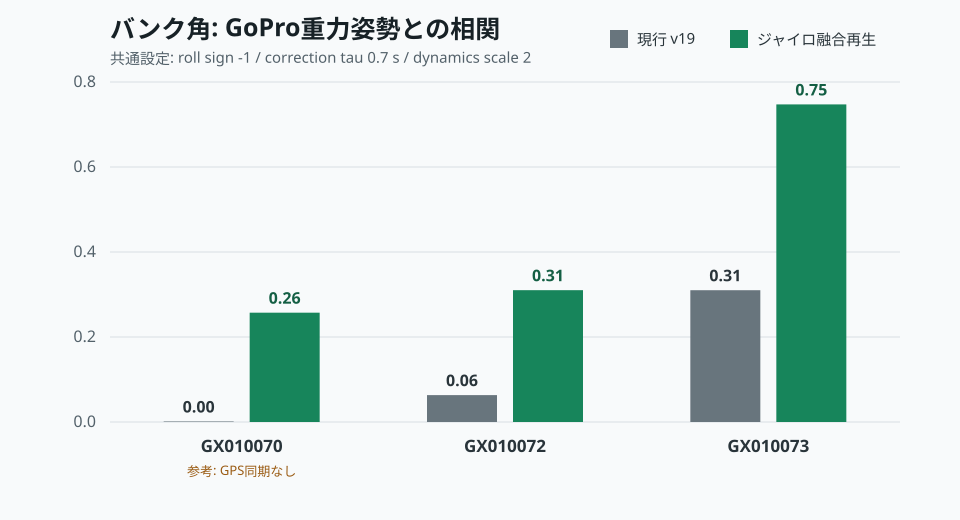

# Gym Ana 実走データ解析レポート 2026-10-11

## 1. 結論

速度推定は、GoPro GPSを利用できた2走行で高い相関を維持した。一方、現行v19のバンク角はGoPro重力姿勢との相関が低く、旋回中の角度変化を十分に追従できていない。特に長時間走行`GX010073`では、アプリのバンク角はGoProロールよりピッチとの相関が高く、前後傾斜の混入が認められた。

保存済みロールレートを使った再生評価では、次の共通設定がGPS同期の良好な2走行で最良となった。

- ロールレート符号: `-1`
- 重力角への補正時定数: `0.7 s`
- 動的加速度に対する観測抑制係数: `2`

この結果をv20のバンク角モデルへ反映した。新モデルはジャイロ積分を短周期の角度変化、重力角を長周期のドリフト補正として利用する。実装の妥当性は次回の実走データで再確認する必要がある。



## 2. データ対応

| アプリCSV | GoPro | 対応 | 備考 |
| --- | --- | --- | --- |
| `01-26-41` | `GX010070` | 対応 | GPX先頭に2021年・座標0の異常点。除外後の開始差10.990秒。GoPro GPS速度比較不可 |
| `07-26-12` | `GX010072` | 対応 | 開始差108.304秒。GPS精度良好 |
| `07-48-26` | `GX010073` | 対応 | 開始差155.845秒。長時間ログ |
| なし | `GX010071` | 対応CSVなし | 動画・GPXのみ |

GoPro動画には約200 Hzの`ACCL`、`GYRO`、約60 Hzの`GRAV`、`CORI`、約10 Hzの`GPS9`が含まれていた。GoPro GPMFの`GRAV`は重力方向ベクトルであり、本データでは第2成分が鉛直である。Hero 8以降で報告されている`[X,Z,Y]`順を用い、`atan2(X,Z)`をGoPro側ロール角とした。

## 3. 速度評価

| 走行 | アプリ速度相関 | アプリ速度RMSE | iPhone GPS RMSE | 備考 |
| --- | ---: | ---: | ---: | --- |
| `GX010070` | n.a. | n.a. | n.a. | GoPro GPS速度が有効でない |
| `GX010072` | 0.989 | 1.51 km/h | 1.15 km/h | v19の速度は良好 |
| `GX010073` | 0.984 | 2.18 km/h | 2.09 km/h | アプリ速度バイアス -1.37 km/h |

`GX010072`のAuto START時点ではアプリ0 km/hに対してGoProは約5.0 km/hだった。IMU同期差は約-0.3秒であるため、発進判定の遅れだけでなく、端末とGoProのUTC基準差も含む可能性がある。次回はSTART前の静止区間を両機器で10秒以上確保して同期を検証する。

## 4. バンク角評価

| 走行 | 現行相関 | ジャイロ融合再生 | 現行中心化RMSE | 再生中心化RMSE | GoPro角度標準偏差 |
| --- | ---: | ---: | ---: | ---: | ---: |
| `GX010070` | 0.001 | 0.257 | 6.53 deg | 9.97 deg | 6.28 deg |
| `GX010072` | 0.063 | 0.310 | 1.51 deg | 1.30 deg | 1.01 deg |
| `GX010073` | 0.310 | 0.747 | 3.52 deg | 2.47 deg | 3.69 deg |

`GX010070`はGoPro GPSによる時刻検証ができず、前後Gから求めた同期差も+3.5秒と大きい。このため係数選定には使用せず参考値とした。`GX010072`と`GX010073`では共通設定で相関と中心化RMSEがともに改善した。

現行モデルの問題は次のとおりである。

- バンク状態を左右Gの釣り合い角へ近づけており、実際のロール運動を直接積分していない
- 加速度を含む重力観測を旋回中も固定ノイズで利用している
- 長時間走行でバンク角の変動幅がGoProより小さい
- `GX010073`ではGoProロール相関0.310に対してGoProピッチ相関0.471となり、軸混入が示唆される

## 5. v20変更内容

バンク角の予測式を次へ変更した。

```text
bank_k = bank_(k-1) - roll_rate * dt
```

重力由来バンク角の観測分散を動的に変更する。

```text
dynamics = |long_g| + |lat_g| + vibration_g
R_bank = 30 * exp(min(4, 2 * dynamics))
```

旋回、加減速、振動が強い区間ではジャイロを優先し、低運動区間では重力角で積分ドリフトを戻す。次回解析のため、CSVへ`gravity_bank_deg`を追加した。

## 6. 発進・停止

| ログ | START | STOP | 停止候補 |
| --- | --- | --- | --- |
| `01-26-41` | Auto | Auto、66.04秒 | 最後の約0.95秒で成立 |
| `07-26-12` | Auto | 手動、89.57秒 | 断続的に116サンプル |
| `07-48-26` | 手動、走行中開始 | 手動、276.36秒 | なし |

`01-26-41`ではv19の停止候補表示・ログ記録が意図どおり動作し、950 ms保持後に自動停止した。`07-26-12`は停止候補が断続的で、最終的に手動停止された。候補の連続時間と解除理由を今後も確認する。

## 7. 次回試験

1. v20を使用し、走行前に車体直立でCalibrationする。
2. Auto待機前にiPhoneとGoProを10秒以上静止させる。
3. 左右それぞれ同程度の旋回を含む走行を2本以上記録する。
4. 可能なら停止状態で車体を既知の10度、20度へ傾け、デジタル角度計と比較する。
5. CSVの`bank_deg`、`gravity_bank_deg`、`roll_rate_dps`をGoPro `GRAV`と比較する。

静的な既知角度試験で±3度以内、動的なGoPro比較で相関0.8以上かつ中心化RMSE 3度以内を暫定合格基準とする。

## 8. 制約

- GoProとiPhoneの取付面は異なるため、定数オフセットを除いた中心化RMSEも併用した。
- GoPro `GRAV`の軸順はGPMF公開情報と実データの鉛直成分から判断した。カメラ機種・取付方向変更時は再確認が必要である。
- 再生評価はv19が保存したバンク角を低周波観測として使用しており、v20そのものの実走結果ではない。
- `GX010071`は対応CSVがなく、モデル比較には使用していない。
