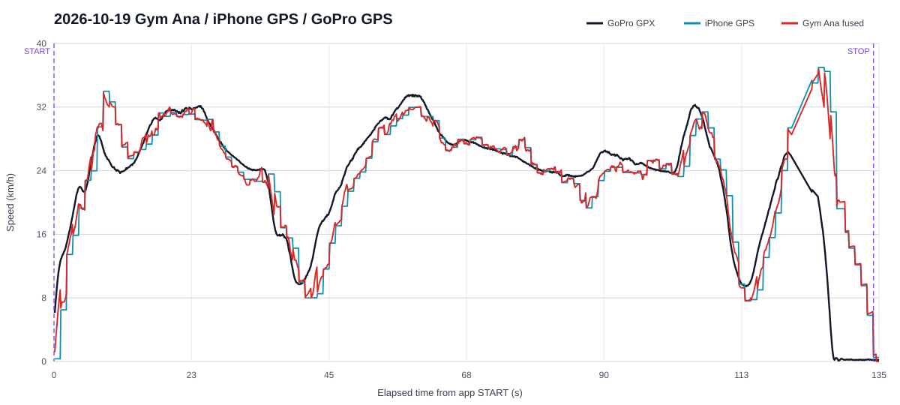

# 走行データ解析レポート（2026-10-19）

## 1. 結論

`gym-ana-2026-10-19T06-47-39-185Z.csv`は`GX010078.gpx`および`GX010078.MP4`と対応する。自動START時のGoPro GPSは`0.32 km/h`、自動STOP時は`0.20 km/h`であり、今回の開始・終了判定は妥当である。計測時間は`134.117秒`、最高速度はアプリ`36.906 km/h`、iPhone GPS`36.987 km/h`だった。

速度モデルはGoPro GPSに対して時刻補正後RMSE `3.899 km/h`、iPhone GPSは`3.740 km/h`だった。今回を含む全9走行の再シミュレーションでも候補係数の改善は`0.68%`に留まったため、速度係数は変更しない。

ただしCSVの記録本体は`app_version=legacy`、`schema_version=1`で、v25の発進前5秒サンプルは0件だった。CSV列だけは新形式なので、旧版で記録した保存走行を新版から出力したと判断する。v25の未発進診断とSTART遅延は今回のデータでは評価できない。

## 2. ファイル対応

|ファイル|UTC範囲|用途|
|---|---|---|
|`gym-ana-2026-10-19T06-47-39-185Z.csv`|06:47:39.185から06:49:54.235|iPhone走行ログ|
|`GX010078.gpx` / `GX010078.MP4`|06:45:49.600から06:50:28.500|対応するGoPro基準|
|`GX010079.gpx` / `GX010079.MP4`|07:21:31.899から07:24:20.399|対応するiPhone CSVなし|
|`GX010080.gpx` / `GX010080.MP4`|07:30台から07:36:05.199|対応するiPhone CSVなし。先頭に異常な2021年時刻を含む|

位置情報を含む元GPXとCSVはGitへ格納しない。解析JSONには座標系列を保存していない。

## 3. 自動計測

|項目|結果|
|---|---:|
|START|06:47:39.185 UTC|
|START時GoPro GPS|0.32 km/h|
|STOP候補開始|06:49:53.302 UTC|
|STOP時GoPro GPS|0.20 km/h|
|自動保存|STARTから135.073秒|
|走行サンプル|8,097件|
|発進前サンプル|0件|

停止イベントは停止保持の開始時刻へ遡って記録されるため、保存時刻との差約0.96秒は設計どおりである。STARTとSTOPの速度はいずれも停止域にあり、走行中の誤検知ではない。

## 4. 速度比較

|評価|アプリ融合速度|iPhone GPS|
|---|---:|---:|
|GoPro波形との相関|0.877|0.887|
|時刻補正後RMSE|3.899 km/h|3.740 km/h|
|平均バイアス|+0.404 km/h|+0.274 km/h|

今回も融合速度はiPhone GPS単独をわずかに下回った。GoPro MP4との絶対時刻比較では融合速度RMSE `4.285 km/h`、iPhone GPS `4.346 km/h`でほぼ同等である。単独走行に最適化すると改善候補は得られるが、日付をまたぐ再現性がない。

## 5. 加速度・姿勢比較

|信号|相関|RMSE|判定|
|---|---:|---:|---|
|前後G|0.818|0.052 G|良好|
|左右G|0.564|0.039 G|傾向は一致、旋回量が小さい|
|投影ヨーレート|0.416|3.397 deg/s|改善余地あり|
|バンク角|0.776|中心化2.560度|形状は良好、固定偏差あり|

バンク角の平均偏差は約`-6.15度`で、取付角またはGoPro座標系との差が主因と考えられる。中心化後の誤差は小さいため、動的波形よりゼロ点補正が課題である。今回だけで符号や係数を変更すると過去走行を悪化させる可能性があるため、変更しない。

## 6. 全データ再シミュレーション

|評価|現行|最良候補|改善率|採用|
|---|---:|---:|---:|---|
|時刻補正後RMSE|3.948 km/h|3.921 km/h|0.68%|不採用|
|UTC実時間RMSE|5.193 km/h|5.129 km/h|1.24%|不採用|

対象は5日分9走行、9,903点である。最良候補は日付別検証で10月4日、10日、12日を悪化させた。採用条件の全体10%以上改善かつ日付別悪化なしを満たさない。

## 7. 版不一致と走行前確認への対策

v27では画面上部に実行中バージョンを表示する。Service Workerはオンライン時に最新版を優先し、新版が有効になったら1回だけ再読込する。オフライン走行時は従来どおりキャッシュから起動する。

走行準備パネルにはセンサー、キャリブレーション、GPS、端末保存、自動待機を表示する。GPSは受信時刻だけでなく観測時刻も2.5秒以内を要求し、古いキャッシュ位置では発進準備を成立させない。端末保存DBが使えない場合は計測開始を禁止する。

次の実走前にWi-Fi環境でアプリを開き、上部が`v27`であることを確認する。今回評価できなかった項目は、発進前サンプルが約300件、`app_version=v27`、`schema_version=2`で出力されること、および連続3走で再待機することである。
